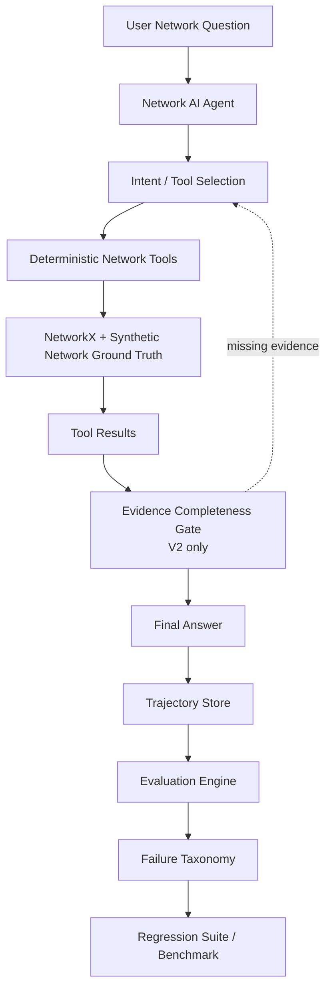
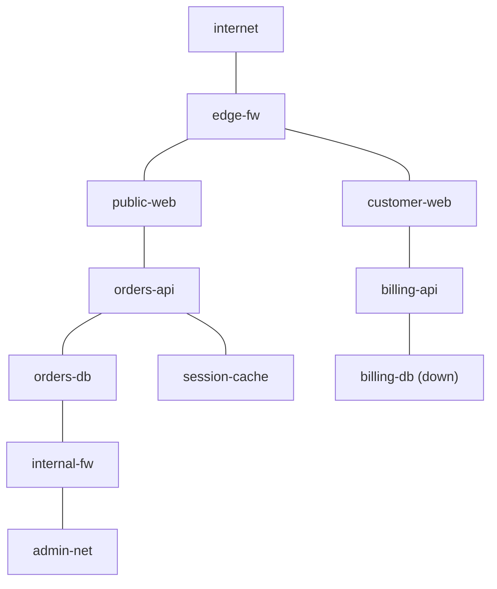

# NetEval  Agent Reliability Lab for Network AI

NetEval is an evaluation-driven reliability framework for network AI agents.

It captures full agent trajectories—tool selection, arguments, deterministic tool results, intermediate investigation steps, and final responses—then evaluates them against deterministic network ground truth.

> **The LLM decides what to investigate. Deterministic code decides what is true.**

## The problem

LLM agents can produce network answers that sound convincing while being wrong. Common failure modes include:

- selecting the wrong tool;
- passing the wrong device, endpoint, or port;
- answering before gathering enough evidence;
- making unnecessary or repeated tool calls;
- misreading deterministic tool results;
- adding claims that the evidence does not support;
- skipping required investigation steps; and
- regressing after prompt or context changes.

Final-answer accuracy alone does not reveal how an agent reached its conclusion. NetEval evaluates the complete trajectory: what the agent investigated, the arguments it used, the evidence it received, whether it stopped at the right time, and whether its final answer stayed grounded in that evidence.

## Architecture



The V2 evidence gate can reject a premature final answer and return control to the agent. It does not execute a tool or create evidence on the model's behalf.

## Synthetic network ground truth

NetEval uses a small enterprise-style network that is deterministic enough for repeatable evaluation while still supporting path analysis, ACL investigation, device failures, and multi-step diagnosis.



The ground truth in [data/network.json](data/network.json) describes:

- devices and their `up` or `down` state;
- external, DMZ, application, data, and admin zones;
- exposed services and ports;
- physical links;
- explicit ACL rules; and
- a default-deny policy.

The topology includes `internet`, `edge-fw`, `public-web`, `orders-api`, `orders-db`, `session-cache`, `customer-web`, `billing-api`, `billing-db`, `internal-fw`, and `admin-net`. It is a controlled evaluation fixture, not a full network simulator or production digital twin.

## Deterministic tools

The agent can call five Python tools:

| Tool | Purpose | Example use |
|---|---|---|
| `check_reachability(source, destination, port)` | Combines topology, endpoint state, and policy to decide whether traffic is reachable. | Check whether `orders-api` can reach `orders-db` on 5432. |
| `trace_path(source, destination)` | Returns the topology path without making a policy or reachability claim. | Show the hops from `admin-net` to `orders-db`. |
| `inspect_acl(device, source=None, destination=None, port=None)` | Returns ACL rules on a device, optionally filtered by traffic attributes. | Inspect `internal-fw` for the admin-to-orders PostgreSQL rule. |
| `get_device_state(device)` | Returns a device's state, zone, type, and service metadata. | Check whether `billing-db` is up. |
| `find_blocking_hop(source, destination, port)` | Finds a deterministic blocking reason and, when available, its device and rule. | Identify what blocks admin access to the orders database. |

The implementations live in [src/tools.py](src/tools.py) and use the NetworkX-backed [src/network_engine.py](src/network_engine.py).

## Agent architecture

The NVIDIA-hosted LLM decides:

- which tool to call;
- which arguments to pass;
- the order of investigation; and
- when it has enough evidence to answer.

Deterministic Python decides:

- topology paths;
- reachability;
- ACL matches;
- blocking devices and rules; and
- device state.

The measured benchmarks use `nvidia/nemotron-3-super-120b-a12b` through NVIDIA's OpenAI-compatible API. Credentials are loaded from environment variables and are never included in trajectories or benchmark artifacts.

## Evaluation dataset

[data/eval_cases.json](data/eval_cases.json) contains 18 deterministic cases across six categories:

- simple reachability;
- path analysis;
- device state;
- ACL investigation;
- root cause; and
- multi-step troubleshooting.

Each case can specify expected or required tools, required arguments, required evidence, the expected outcome, and a reasonable tool-call budget. The format permits multiple valid investigation paths where the network question can be solved in more than one grounded way.

## Deterministic scoring

The evaluator assigns normalized component scores with these weights:

| Component | Weight |
|---|---:|
| Tool selection | 20% |
| Arguments | 20% |
| Trajectory quality | 20% |
| Grounding | 20% |
| Final answer | 15% |
| Efficiency | 5% |

A case succeeds when its overall score is at least `0.80` and it has no critical failure. Critical failures are missing a required tool, using a wrong entity or port, answering prematurely, misreading a tool result, making an unsupported claim, or producing an invalid result format.

The complete failure taxonomy is:

- `wrong_tool`
- `missing_required_tool`
- `wrong_arguments`
- `wrong_entity`
- `wrong_port`
- `wrong_tool_order`
- `premature_answer`
- `unnecessary_tool_call`
- `missing_step`
- `tool_result_misread`
- `unsupported_claim`
- `format_failure`

## Measured V1 and hardened V2 results

These are real results from the preserved [V1 benchmark](results/benchmark_v1.json) and the primary improved [hardened V2 benchmark](results/benchmark_v2_hardened.json), using the same model, network, tools, and 18 evaluation cases.

| Metric | V1 | Hardened V2 |
|---|---:|---:|
| Task success | 61.11% | 88.89% |
| Overall score | 0.7534 | 0.9756 |
| Tool selection | 72.22% | 94.44% |
| Arguments | 70.83% | 100.00% |
| Trajectory | 85.00% | 97.96% |
| Grounding | 78.15% | 100.00% |
| Final answer | 66.67% | 95.37% |
| Efficiency | 81.94% | 95.37% |
| Average tool calls | 1.833 | 1.389 |
| Average total tokens | 3,643.06 | 6,198.33 |

Hardened V2 made fewer tool calls and achieved stronger trajectory quality, grounding, and task success. Its token use increased because the prompt and runtime evidence checks carried more context. The NVIDIA provider also produced occasional transient API errors during benchmark work, and repeated regression runs exposed stochastic behavior even with deterministic tools and scoring.

## What changed from V1 to V2

Three failures shaped the V2 design:

1. **Wrong tool for a path question.** V1 repeatedly selected `get_device_state` instead of `trace_path`. Clear intent-specific tool descriptions helped path-analysis success improve from 33.3% in V1 to 100% in the measured hardened V2 benchmark.
2. **Reachability inferred from topology.** A physical path does not prove that policy permits traffic. V2 explicitly separates path evidence from reachability evidence and tells the model to make only the claim supported by the selected tool.
3. **Only half of a compound request was answered.** A question asking for both a route and a diagnosis needs evidence for both. V2 added compound-intent guidance and evidence-completeness tracking before accepting a final response.

## Evidence completeness gate

Before the V2 tool loop begins, lightweight deterministic heuristics derive evidence requirements from the user's language. For example:

- a path question requires `trace_path` evidence;
- a path-and-reachability question requires both `trace_path` and `check_reachability`;
- a diagnostic `destination_down` result requires `get_device_state` evidence for the destination; and
- an `explicit_deny` diagnosis requires ACL evidence when the user asks for a policy explanation.

When the model attempts to answer with required evidence still missing, the gate rejects the premature completion and asks it to continue investigating within the existing tool-round limit. The guardrail never executes the missing tool automatically; the LLM still chooses the next action.

Trajectories record the guardrail through:

- `evidence_requirements`
- `evidence_satisfied`
- `evidence_gate_triggers`

This metadata makes recovered premature answers observable rather than hiding them.

## Regression and repeated-run stability

The regression suite contains six cases that represent meaningful V1 failures fixed by V2. A later two-run stability experiment produced:

- Run 1: **5/6** passing
- Run 2: **6/6** passing

The system therefore showed improved, but not perfect, repeated-run stability. A single successful trajectory is not proof of reliability, which is why repeated execution is a useful complement to deterministic scoring.

In three repeated targeted runs per case, `multi_02` passed **3/3** and `multi_03` passed **3/3**. One `multi_02` run triggered the evidence gate, which rejected an incomplete response and successfully recovered the missing path evidence.

## Demo scenarios

### 1. Simple reachability

> Can orders-api reach orders-db on port 5432?

The expected primary tool is `check_reachability`, which can answer this directly from topology, state, and policy.

### 2. Root-cause diagnosis

> Why can't admin-net reach orders-db on port 5432?

A concise valid trajectory is:

```text
check_reachability
inspect_acl
```

The evidence identifies `internal-fw`, rule `acl-17`, and an explicit deny.

### 3. Evidence-gated compound request

Ask for both a path and a reachability or diagnostic conclusion. If the model tries to answer after collecting only one evidence class, V2 records a gate trigger, requests the missing investigation, and accepts the answer only after the required tool evidence is present.

See [DEMO.md](DEMO.md) for a five-minute walkthrough.

## Setup and CLI usage

Create and activate a local environment on Windows PowerShell:

```powershell
python -m venv .venv
.venv\Scripts\Activate.ps1
python -m pip install --upgrade pip
pip install -r requirements.txt
```

Create `.env` from [.env.example](.env.example):

```dotenv
NVIDIA_API_KEY=
NVIDIA_BASE_URL=https://integrate.api.nvidia.com/v1
NVIDIA_MODEL=nvidia/nemotron-3-super-120b-a12b
```

Run one V2 query:

```powershell
python -m src.agent --agent-version v2 "Why can't admin-net reach orders-db on port 5432?"
```

Run a V1 benchmark without overwriting the preserved primary artifact:

```powershell
python -m src.runner --agent-version v1 --output "$env:TEMP\neteval_benchmark_v1.json"
```

Run a V2 benchmark and compare it with the preserved V1 benchmark:

```powershell
python -m src.runner --agent-version v2 --output "$env:TEMP\neteval_benchmark_v2.json" --compare-v1 --comparison-output "$env:TEMP\neteval_comparison.json"
```

Run the V2 regression suite:

```powershell
python -m src.runner --regression --agent-version v2
```

Benchmark and regression commands make live NVIDIA API calls. Run the offline test suite with:

```powershell
python -m pytest
```

## Repository structure

```text
NetEval/
├── data/
│   ├── network.json
│   ├── eval_cases.json
│   └── regression_cases.json
├── src/
│   ├── agent.py
│   ├── network_engine.py
│   ├── tools.py
│   ├── trajectory_store.py
│   ├── evaluator.py
│   ├── runner.py
│   └── report.py
├── results/
│   ├── trajectories/
│   ├── benchmark_v1.json
│   ├── benchmark_v2_hardened.json
│   └── regression_v2.json
├── tests/
├── DEMO.md
├── INTERVIEW_NOTES.md
└── requirements.txt
```

- `data/` contains network and evaluation ground truth.
- `src/` contains the agent, deterministic tools, evaluator, runner, and reporting code.
- `results/` contains trajectories and measured benchmark artifacts.
- `tests/` contains offline unit and regression-related tests.

## Limitations

- The network data is synthetic rather than production telemetry.
- ACL semantics are intentionally simplified.
- The evaluator uses deterministic string and value matching rather than semantic grading.
- The measured study uses one primary LLM.
- Provider latency and API availability vary between runs.
- Evidence-intent detection uses lightweight deterministic heuristics.
- Repeated-run stability is improved but not perfect.
- NetEval is an agent-evaluation framework, not a replacement for a production digital twin.

## Future work

- Add an LLM judge for explanation quality while retaining deterministic core scores.
- Compare multiple models under the same cases and tools.
- Support richer routing and network-policy semantics.
- Retrieve relevant context from much larger network models.
- Gate releases with regression tests in CI.
- Report repeated-run reliability distributions.
- Integrate production telemetry and distributed tracing.
